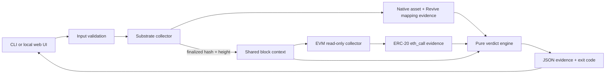

# Architecture

## Trust boundaries

- The Substrate and EVM endpoints are independent external inputs. Agreement is measured; neither endpoint is assumed truthful merely because it responded.
- The finalized Substrate height defines the comparison context. EVM must serve that exact height or cross-surface checks become `UNKNOWN`.
- Runtime metadata is fetched and hashed at the pinned Substrate block. Pallet presence and the `portaldot-v3` spec name define the current support envelope.
- Revive's `OriginalAccount` storage is the authority for the EVM-to-native account mapping. FIRMA does not hash, truncate, or guess an AccountId.
- JSON-RPC response data remains in the exported report so a result is inspectable rather than merely asserted.

## Read-only call surface

EVM: `eth_chainId`, `web3_clientVersion`, `eth_getBlockByNumber`, and `eth_call`.

Substrate: system identity, finalized head/header, runtime version, runtime metadata, and storage queries for `Assets` and `Revive`. The implementation never accesses `api.tx`, `author_submitExtrinsic`, transaction broadcast APIs, signing APIs, or wallet extensions.

