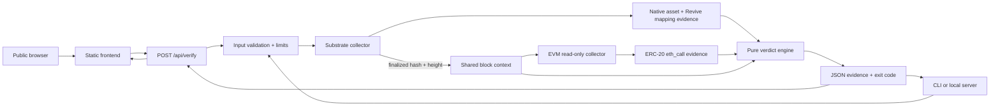

# Architecture

## Trust boundaries

- The Substrate and EVM endpoints are independent external inputs. Agreement is measured; neither endpoint is assumed truthful merely because it responded.
- The finalized Substrate height defines the comparison context. EVM must serve that exact height or cross-surface checks become `UNKNOWN`.
- Runtime metadata and the `:code` storage hash are fetched at the pinned Substrate block. Support requires an exact reviewed profile: genesis hash, finalized runtime-code hash, runtime and metadata versions, EVM chain ID, required pallets, and required `Assets`/`Revive` query surfaces.
- The raw metadata SHA-256 is exported as block-specific evidence but is not used as an approval key. Portaldot V3 metadata contains a block-varying `Revive.EthBlockBuilderIR` fallback even when the runtime code is unchanged.
- Revive's `OriginalAccount` storage is the authority for the EVM-to-native account mapping. FIRMA does not hash, truncate, or guess an AccountId.
- JSON-RPC response data remains in the exported report so a result is inspectable rather than merely asserted.
- EVM HTTP responses are streamed under a 512 KiB ceiling before JSON parsing. Successful responses must use JSON-RPC 2.0, match the request ID, and contain exactly one of `result` or `error`.
- Dynamic ABI strings are accepted only in the canonical one-value encoding with a 32-byte offset, aligned exact payload, zero padding, and strict UTF-8.

## Imported-report verification

`firma.report.v1` remains the exported artifact format. `firma.independent-verification.v2` separates four conclusions that must not be conflated:

- `firma.report.v1` includes both complete observations and structurally bounded unavailable-evidence states emitted by the verifier. An exported `UNKNOWN` report remains importable, but the checker returns historical `UNAVAILABLE` when the original run never obtained a finalized block; it never substitutes current state.

- `reportValidation.structure` confirms the supported schema and bounded JSON shape.
- `reportValidation.evidenceConsistency` confirms that block tags, derived addresses, decoded values, request transcripts, and duplicated verdict content agree internally.
- `historical.overall` reports only whether supported blockchain claims reproduced as `VERIFIED`, `MISMATCH`, or `UNAVAILABLE`.
- `authentication.status` is `AUTHENTICATED` only when an independently supplied trusted commitment matches the complete report. A locally recomputed hash without that trust anchor is `UNANCHORED`.

The aggregate result is `AUTHENTICATED`, `REPRODUCED`, `MISMATCH`, or `UNAVAILABLE`. `REPRODUCED` means internally consistent historical claims reproduced but report origin/authenticity remains unanchored. Fields that are not historical blockchain claims are listed explicitly in `reportValidation.notHistoricallyReproducible`.

## Read-only call surface

EVM: `eth_chainId`, `web3_clientVersion`, `eth_getBlockByNumber`, and `eth_call`.

Substrate: system identity, genesis hash, finalized head/header, runtime version, runtime metadata, the finalized `:code` storage hash, and storage queries for `Assets` and `Revive`. The implementation never accesses `api.tx`, `author_submitExtrinsic`, transaction broadcast APIs, signing APIs, or wallet extensions.

## Deployment shape

- `public/` is copied to `dist/` as immutable build output.
- `api/verify.mjs` is a stateless Node.js Vercel Function using the Web Request/Response API.
- The function owns no durable state and closes its outbound Substrate connection after each request.
- Application limits protect each warm instance. The `firma` project additionally has a live Vercel fixed-window rule covering `/api/` at 10 requests per minute per IP; function memory is still not treated as shared state.
- `server.mjs` remains the loopback-only local development adapter; it is not the production entrypoint.

