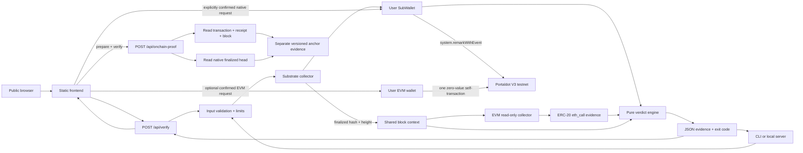

# Architecture

## Trust boundaries

- The Substrate and EVM endpoints are independent external inputs. Agreement is measured; neither endpoint is assumed truthful merely because it responded.
- The finalized Substrate height defines the comparison context. EVM must serve that exact height or cross-surface checks become `UNKNOWN`.
- Runtime metadata and the `:code` storage hash are fetched at the pinned Substrate block. Support requires an exact reviewed profile: genesis hash, finalized runtime-code hash, runtime and metadata versions, EVM chain ID, required pallets, and required `Assets`/`Revive` query surfaces.
- The raw metadata SHA-256 is exported as block-specific evidence but is not used as an approval key. Portaldot V3 metadata contains a block-varying `Revive.EthBlockBuilderIR` fallback even when the runtime code is unchanged.
- Revive's `OriginalAccount` storage is the authority for the EVM-to-native account mapping. FIRMA does not hash, truncate, or guess an AccountId.
- JSON-RPC response data remains in the exported report so a result is inspectable rather than merely asserted.
- The user's injected wallet is a separate trust boundary. Native signing uses the SubWallet-compatible injected signer in the browser; EVM signing uses the injected EIP-1193 provider. The server never receives signing material and cannot broadcast a transaction.
- The original `firma.report.v1` object is hashed and preserved; anchoring evidence is emitted separately and never rewrites the report verdict.
- Anchoring preparation is fail-closed to an original report whose technical overall verdict is `PASS`; `FAIL` and `UNKNOWN` reports cannot reach wallet fee review.

## Read-only call surface

EVM: `eth_chainId`, `web3_clientVersion`, `eth_getBlockByNumber`, and `eth_call`.

Substrate: system identity, genesis hash, finalized head/header, runtime version, runtime metadata, the finalized `:code` storage hash, and storage queries for `Assets` and `Revive`. Server code never accesses `api.tx`, `author_submitExtrinsic`, transaction broadcast APIs, signing APIs, or wallet extensions.

Anchor verification adds read-only EVM transaction/receipt/block calls and native block, extrinsic, event, runtime, and finality queries. Browser-only signing surfaces are `eth_sendTransaction` for EVM and `signAndSend` with the injected SubWallet signer for native. Each is unreachable until preparation, fee review, a checked confirmation control, and a final account/network recheck have succeeded. There is no automatic submission or resubmission.

## Native remark protocol

The preferred payload is `0x4649524d410002 || commitment`, submitted as `system.remarkWithEvent` by an explicitly selected SS58 account. Preparation is fail-closed to genesis `0xd4f9acbc…83bd`, runtime code `0xedc03c9d…c7c2`, runtime `portaldot-v3/3002`, transaction version `2`, and call availability. The `firma.anchor.native.v1` sidecar records the extrinsic hash, canonical finalized block, index, signer, payload, and estimate. Independent verification retrieves the actual block and scoped system events; it never trusts the sidecar hash alone.

## Contractless protocol

The transaction destination is the signing EVM account itself, value is zero, and calldata is `0x4649524d410001 || commitment`. The verifier requires destination, value, chain identity, calldata, successful receipt, canonical inclusion, and available native finality evidence to agree. A demonstrated contradiction is `MISMATCH`; missing or inconclusive evidence is `UNAVAILABLE`. The existing `FirmaEvidenceRegistry` remains experimental and undeployed because the contractless transaction satisfies the current commitment requirement without a deployment.

## Deployment shape

- `public/` is copied to `dist/` as immutable build output.
- `api/verify.mjs`, `api/check-report.mjs`, and `api/onchain-proof.mjs` are stateless Node.js Vercel Functions using the Web Request/Response API.
- The function owns no durable state and closes its outbound Substrate connection after each request.
- Application limits protect each warm instance. A platform firewall rule is required for a global public rate limit because function memory is not shared across instances.
- `server.mjs` remains the loopback-only local development adapter; it is not the production entrypoint.

