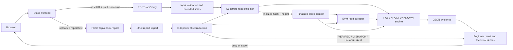

# Architecture

## Current production flow

The browser is static. It does not contact chain endpoints directly. It sends either a new verification request or an uploaded report to one of two stateless server functions.

### New verification

`api/verify.mjs` validates the asset ID and public H160 account, applies request limits, and invokes the verifier. The Substrate collector obtains a finalized head, runtime identity, native asset state, and Revive account mapping. The EVM collector requests that same block number and performs the allowed ERC-20-compatible reads. The pure verdict engine returns `PASS`, `FAIL`, or `UNKNOWN`, and the browser can export the complete `firma.report.v1` record.

### Independent report reproduction

`api/check-report.mjs` bounds and strictly parses an uploaded report. Endpoint URLs inside the report are evidence only and are never used as query targets. The independent verifier uses configured endpoints, confirms that the requested block is finalized, reproduces the supported native and EVM observations at that exact height, and returns `VERIFIED`, `MISMATCH`, or `UNAVAILABLE`. It does not alter the imported report's original verdict.

## Trust boundaries

- The Substrate and EVM endpoints are independent external inputs. Agreement is measured; a response is not assumed truthful merely because it arrived.
- The finalized Substrate height defines the comparison context. If the EVM endpoint cannot serve that exact height, dependent checks are `UNKNOWN` or `UNAVAILABLE`.
- Runtime interpretation is allowed only when genesis, runtime code, version, EVM chain ID, required pallets, and query surfaces match the reviewed profile.
- `Revive.OriginalAccount` is the authority for H160-to-native account mapping. FIRMA does not guess or derive an AccountId when the mapping is missing.
- Uploaded reports are untrusted input. Size, JSON structure, schema, internal consistency, and supported claim fields are validated before network work.
- Raw RPC observations remain in evidence for inspection. They are not cryptographic state proofs.

## Read-only call surface

EVM verification uses `eth_chainId`, `web3_clientVersion`, `eth_getBlockByNumber`, and `eth_call`.

Substrate verification uses system identity, genesis and finalized block reads, runtime version and metadata, the finalized runtime `:code` hash, and storage queries for Assets and Revive.

Production code does not use wallet extensions, signing APIs, `author_submitExtrinsic`, transaction broadcast methods, or private keys.

## Deployment shape

- `public/` is copied into `dist/` as the static application, including `privacy.html`.
- `api/verify.mjs` and `api/check-report.mjs` are the two production functions declared in `vercel.json`.
- Each request opens bounded outbound connections and owns no durable application state.
- Rate limiting in function memory is per warm instance. Platform-level protection is an operator responsibility.
- `server.mjs` is the loopback-only local adapter.

## Experimental and future work

`experimental/onchain-proof/` contains isolated contract, build, estimation, and receipt-validation research. It is not imported by the browser or production API routes, and no deployment is claimed.

Transaction submission, wallet connection, asset transfer, and transaction evidence workflows are not current functionality. Any future transaction work requires separate authorization, funded disposable accounts, explicit user approval, a new threat model, and preservation of FIRMA's fail-closed evidence semantics.
